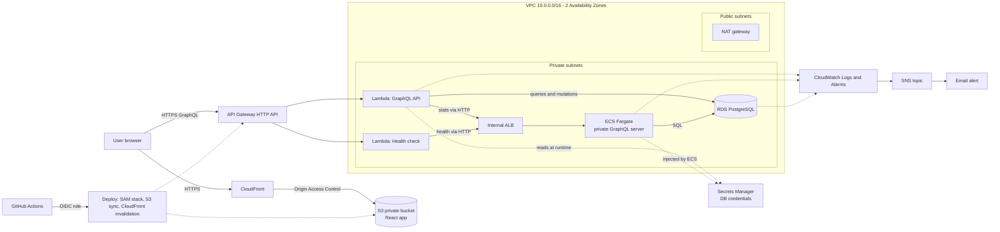

# Architecture

## Components

| Layer | Service | Notes |
|---|---|---|
| Frontend | S3 + CloudFront | Private bucket, Origin Access Control, HTTPS, caching, security headers |
| Public API | API Gateway HTTP API + Lambda (TypeScript, Node.js 24, arm64) | `POST /graphql` (queries, mutations) and `GET /health` |
| Private service | ECS Fargate behind an internal ALB | Apollo Server on Express, no public address |
| Database | RDS PostgreSQL 16 | Private subnets, encrypted, managed credentials in Secrets Manager |
| CI/CD | GitHub Actions with OIDC | Test, then deploy the Lambda stack and the frontend |
| Monitoring | CloudWatch + SNS | Alarms by email |
